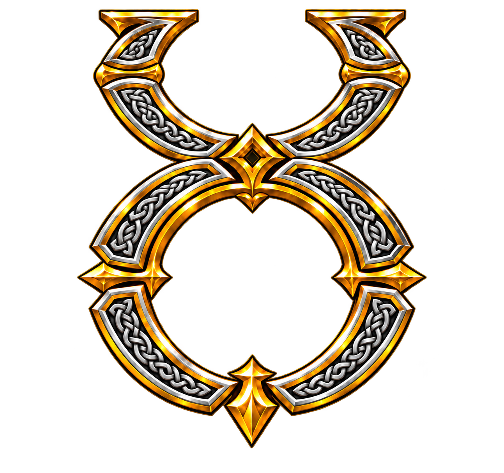
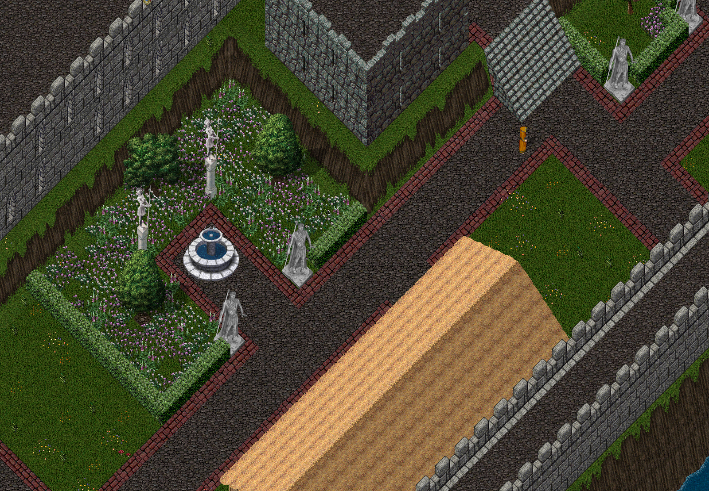

# GodotUO

<p align="center">
  
</p>

**Classic Ultima Online on Godot .NET.** GodotUO (GUO) carries over
ClassicUO's C# game logic, networking and data readers, with Godot hosting
rendering, input, audio and world/asset authoring tools.



**Pre-release.** Playable local-shard workflows have historical validation;
complete gameplay, pixel parity and support for every shard/device are not
claimed. You supply your own legally obtained UO installation. No game data
is included or redistributed.

## Start here

| Goal | Guide |
|---|---|
| Build, install or update | [Getting started](docs/wiki/Getting-Started.md) · [Install and update](docs/wiki/Install-and-Update.md) |
| Play and configure | [Gameplay and settings](docs/wiki/Gameplay-and-Settings.md) · [Renderer and recovery](docs/wiki/Renderer-and-Performance.md) |
| Author worlds and assets | [Editor](docs/wiki/Editor.md) · [Assets and Fiddler](docs/wiki/Assets-and-Fiddler.md) · [World editing](docs/wiki/World-Editing.md) |
| Use AI or automation | [AI and MCP](docs/wiki/AI-and-MCP.md) · [Scripted runs](docs/wiki/Scripted-Runs-and-Probes.md) |
| Check scope and proof | [Feature coverage](docs/wiki/Feature-Coverage.md) · [Visual guide](docs/wiki/Visual-Guide.md) · [Known issues](docs/wiki/Known-Issues.md) |

The [GitHub Wiki](https://github.com/DatMoshu/GodotUO/wiki) is published from
the reviewed [documentation source](docs/wiki/Home.md).

## Build on Windows

Requirements: Godot **4.7.2 .NET** (bootstrap fetches the pin), **.NET SDK 10**
with desktop .NET 8 runtime, **Python 3.12+**, Git and your own Classic UO data.
See the target guide for Android/web .NET 9 and platform-specific dependencies.

```bat
launchers\pipeline\00_bootstrap.bat
copy launchers\_shared\config.local.bat.example launchers\_shared\config.local.bat
notepad launchers\_shared\config.local.bat
REM Set UO_CLIENT_DATA, an external UO_BUILD_DIR, and your shard host/port.
launchers\pipeline\01_verify_client_data.bat
dotnet build godot\GUO\GUO.csproj
launchers\dev\smoke.bat
launchers\game\play.bat
```

The default server address is loopback port 2593; run a
[local ModernUO shard](docs/wiki/Dev-Shard.md) or configure your own server.
Machine settings stay in gitignored local configuration. Generated output,
caches and profiles belong outside the checkout.

## Platforms and feature boundaries

[Windows](docs/wiki/Windows-Build.md) · [Linux](docs/wiki/Linux.md) ·
[Android ARM64](docs/wiki/Android-Build.md) · [Steam Deck](docs/wiki/Steam-Deck.md) ·
[Web community-engine target](docs/wiki/Web-Client.md)

Evidence and limitations differ by target; an export path is not certification
of every device. Controller, touch and dual-screen guides are in the wiki.
The desktop renderer selects production Depth World where supported and keeps
a canvas recovery path. HD art, audio packs and other presentation enhancements
have their own opt-ins. Editor packages are excluded from exported clients;
Labs requires an opted-in Debug build and never ships in an export.

## Contribute

Read [CONTRIBUTING](CONTRIBUTING.md), [AGENTS](AGENTS.md) and the
[architecture guide](docs/wiki/Architecture.md). Compare GUO with ClassicUO at
the same location, camera and settings when reporting rendering issues.
Include the build/commit and reproducible steps; remove private account,
chat, token and machine details from logs and screenshots.

GUO is BSD 2-Clause; see [LICENSE](LICENSE) and [upstream notices](docs/upstream/).
Ultima Online is a trademark of Electronic Arts. This unofficial fan project
is unaffiliated with Electronic Arts or Broadsword Online Games.
