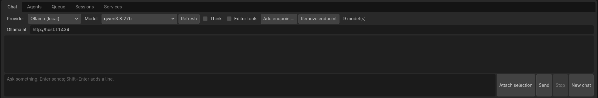
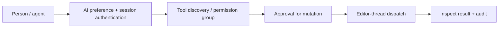
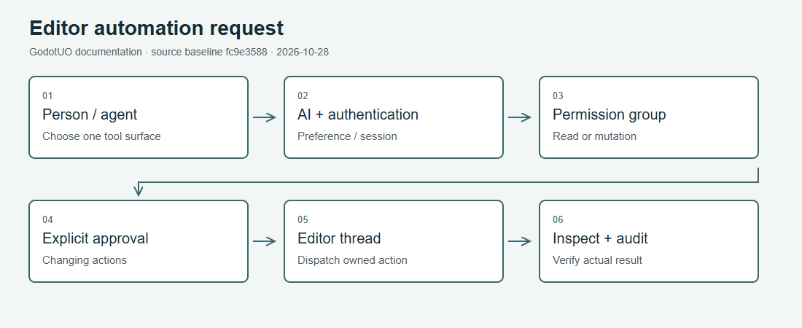

# AI and MCP

Cropped AI dock with an empty conversation. The tour normalizes local endpoint text; no prompt was sent and no provider session was tested. [Capture conditions and limits](Visual-Guide.md#ai-chat).

There are three distinct automation surfaces. Pick the one that owns the
operation; a reference-renderer tool cannot control a running game.

| Surface | Purpose | Enablement |
|---|---|---|
| [guoasset](../../tools/guoasset/README.md) | Render reference UO assets with upstream loaders | Separate MCP program with your own data path |
| [Client MCP](../../tools/guo_mcp/README.md) | Inspect a running desktop debug/source client and dispatch input | `GUO_MCP_PORT` plus matching session token; absent port means no listener; release/mobile/web excluded |
| [Editor MCP](../../tools/editor_mcp/README.md) | Shared editor tool host for MCP, F3 and AI chat | AI preference, explicit port/token, then per-group permissions and mutation approvals |

## Editor AI preference

Editor Settings > GUO > AI > Enabled is `guo/ai/enabled`. Its source default
is **true** when no preference exists. This makes AI available; it does not
configure a provider or give MCP server-write permissions. Turning it off
hides AI/discovery/MCP surfaces and cancels linked work; manual authoring stays
available. Source: [AiFeatures](../../godot/GUO/addons/guo_editor/AI/AiFeatures.cs).
Provider setup, dependencies and supported generation paths are in
[AI Hub](../../tools/ai_hub/README.md), [Comfy tooling](../../tools/comfy/README.md)
and [editor AI workspace](../editor_ai_workspace_plan.md). A configured API or
local service is a separate requirement; do not imply it is bundled.

## Request flow

[SVG fallback](../images/guides/ai-tool-flow.svg)

The editor's read-state, navigation/resize and connect/refresh groups start on.
Save/backup creation, restart, restore/settings, account changes, commands and
godview actions start off. Policy persists in `editor/mcp_access.json` under
the per-user workspace. MCP cannot grant itself permissions. A malformed or
unreadable policy denies all calls and remains available for manual repair;
preserve it before restoring a valid copy. See the
[full access table](../../tools/editor_mcp/README.md).

## Client inspection loop

Follow [Client MCP setup](../../tools/guo_mcp/README.md#start-a-session) to
generate a token in the environment and launch the matching port. Never print
or commit the token. Attach the stdio bridge only after the client is running.

1. `guo_ui` / `guo_state`: inspect the current scene, viewport, bounds and state.
2. `guo_input`: dispatch a bounded pointer/key/text action using viewport pixels.
3. `guo_wait`: allow asynchronous UI/server state to settle (1–600 frames).
4. Inspect state/UI again; use `guo_screenshot` in headed mode for pixels.
5. `guo_quit`: cleanly stop the instance you own when finished.

Inspection caps traversal at 2,000 controls and omits editable values. Headless
mode has UI inspection/input but no rendered screenshots or reliable world
pixel picking. A successful dispatch is not proof the server accepted an action.
Use one controller per instance and separate ports for separate instances.

## Repeatable workflows

[Scenario Runner](../../tools/scenario_run/README.md) records scenarios,
expectations and evidence. Mutations are not silently approved by a scripted
run; an action can fail immediately when approval is unavailable. The
human driver performs actions itself while the runner checks expectations.
See [Working with AI Agents](Working-With-AI-Agents.md) for repository
instructions and [Scripted Runs](Scripted-Runs-and-Probes.md) for probes.
