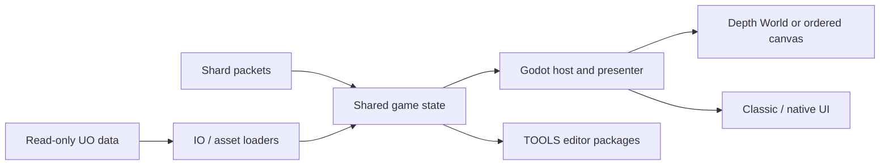
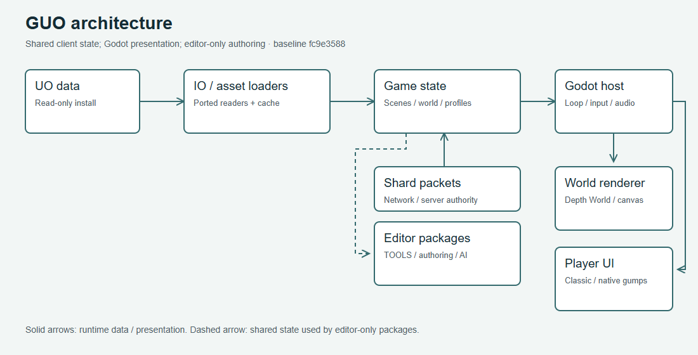

# Architecture

Read `docs\port_plan.md` first; it is short and it explains why the project
is shaped as it is. The binding decisions are Architecture Decision Records
under `docs\architecture\`, indexed in `docs\architecture\README.md`.
Numbers are assigned in that index before an ADR is written so parallel
branches do not collide; the index says which number is free next.
Every proposal also starts by choosing a feature layer, L0 to L4 (see
[Feature Layers](Feature-Layers.md)).

## The port in one paragraph

ClassicUO is transplanted, not rewritten. Every upstream file is classified
by how it binds to FNA: `verbatim` (247 files, renamespace only), `shim`
(116 files, renamespace plus `using GUO.Compat;` for XNA's value types) and
`rewrite` (37 files, reimplemented on Godot). Four fifths of the port is
mechanical, and that ratio is what makes it feasible. The one way to lose it
is letting `GUO.Compat` grow engine behaviour: it holds value types only, and
a shim file that wants a texture or a device is misclassified, not a reason
to grow Compat.

## The ADRs

| # | Title | Status | One line |
|---|---|---|---|
| 0001 | Render presenter seam | Accepted | The one place the ported renderer hands frames to Godot; everything above it is upstream's draw order, everything below is the engine. |
| 0002 | Batcher on Godot canvas | Accepted | `UltimaBatcher2D` becomes a pool of canvas items; the hue index rides in the modulate colour (two channels for a 12-bit hue) into the hue shader. |
| 0003 | Blend states by hand | Accepted, amended | FNA's blend states reproduced in the shader; amended so Additive uses the hardware blend. |
| 0004 | World mesh on canvas meshes | Accepted, amended twice | Land drawn as canvas meshes; amended for land covering sunk statics from below (F1) and for cached statics joining the sort. |
| 0005 | Audio on Godot streams | Accepted | Sounds as `AudioStreamWav`, music through the engine's decoder on a stream player; MP3Sharp is not ported. Verified by `audio_probe.bat`. |
| 0006 | GameController as a Godot node | Accepted | `GameController : Node2D`; `_Process` is the loop, `DisplayServer` is the window, `src\Input\GodotInput.cs` replaces the SDL event filter step for step. |
| 0007 | Sorted world in batched meshes | **Proposed**, recommendation: reject | Draw the sorted world as upstream does, quads appended into one mesh per material run over a `Texture2DArray` atlas. A prototype was measured on 2026-09-27 and the ADR recommends rejecting it. |
| 0008 | Web target | Accepted, as amended | The pinned Godot 4.7.2 mono cannot export C# to the web (godotengine/godot#70796); the export uses a community build that can. See [Web Client](Web-Client.md). |
| 0009 | Second display | Accepted | Shelf gumps on a second Android display through `Presentation`; verified on one device. See [Dual Screen](Dual-Screen.md). |
| 0010 | Editor addon shape | Accepted | The editor add-on in the client assembly behind `#if TOOLS`, with `ISerializationListener` for assembly reloads. |
| 0011 | World project overlay | Accepted | Map edits as whole replaced 8x8 blocks in JSON, drawn over the install by repointing the loader's index entries; no ported file changes. |
| 0012 | Live editing transport | Accepted | A bridge assembly in a private ModernUO instance, JSON lines from editors on loopback, UltimaLive to clients. |
| 0013 | Asset overlay | Retired | The number was not used; the asset overlay is written as 0020. |
| 0014 | Shard world objects and backends | Accepted | A neutral model of shard objects in the world project, native files per backend, and a sync step on the shard. |
| 0015 | Editor world view | Accepted | The client's own renderer embedded in the editor's World tab, proven against a logged-in client by `tools\world_parity`. |
| 0016 | Canvas background | Accepted | A `CanvasLayer` at -1 behind the game: grey, wood, a picture, a video, frames or a shipped loop; per-platform low power. See [Canvas Background](Canvas-Background.md). |
| 0017 | Android target | Accepted | ARM64 debug APK without Gradle, client data in the app's external files, a touch layer that turns fingers into the mouse the game already reads. Was numbered 0007 in the private checkout. See [Android Build](Android-Build.md). |

This table stops at 0017. ADRs 0018 onward (Steam Deck, the Asset Store, the
asset overlay, authoring UO data, post-processing, the editor's Multi editor
and Admin channel, and more) are listed in `docs\architecture\README.md`.

Each ADR has a Status, a Last Verified date, a Context section that is
measured rather than assumed, the alternatives rejected, the consequences,
and a Validation section naming the probe or launcher that re-measures it.
When a page here says something works, that section is where the claim
comes from.

## Current architecture map

The default world route described in early ADRs changed by the audit baseline
`fc9e3588`. [Renderer and Performance](Renderer-and-Performance.md) documents
the current Depth World selection and complete canvas fallback. The older ADR
table below is historical context; use the [full ADR index](../architecture/README.md)
for later decisions.





[SVG fallback](../images/guides/architecture.svg)

## The runtime, top to bottom

```
Bootstrap\Main.cs           the host scene: parses flags, sets the working directory, boots the client
Client\GameController.cs    Node2D; _Ready = Initialize + LoadContent, _Process = Update + DrawFrame   (ADR-0006)
Game\Scenes\*               upstream's scenes, unchanged in what they call and in what order
Game\UI\*                   upstream's gumps, drawn from .mul art by the ported UIManager
Render\*                    the rewrite tier: batcher, atlas, hue shader, world meshes, canvas background   (ADR-0001..0004, 0016)
Input\GodotInput.cs         _Input -> the SDL event shapes the ported code expects   (ADR-0006)
Input\Touch\*               fingers -> mouse events, off unless enabled   (ADR-0017)
Labs\*                      experimental client features: opt-in Debug build (GuoLabs=true), never in an export
Platform\Android\*          the second display   (ADR-0009)
IO\*, Assets\*              upstream's readers and loaders, verbatim; the decode cache under them
Network\*                   upstream's packets, handshake, encryption, compression, verbatim; the plugin host
Configuration\*             settings and profiles, plus PlatformDefaults for the per-platform table
Compat\*                    XNA value types: Vector2, Color, Rectangle and the like. Nothing else.
```

The data contract between the Python tools and the runtime is
`docs\data_formats.md`: the configuration keys, the cache layout, the world
project (section 9) and the bridge protocol (section 10). Extend it before
emitting a new field.

## The rules the ADRs sit under

From AGENTS.md, in force for every change:

1. Never edit `sources\`.
2. Port faithfully; mark unavoidable changes `PORT DEVIATION (GUO)`.
3. Parity before improvement.
4. Build in small batches.
5. Measure, do not estimate; when a file resists its tier, fix the classifier.
6. "Ported" is not "working": claims need a smoke run or a screenshot.
7. Never filter pixel art; `default_texture_filter=0` is deliberate.
8. Never commit game data or credentials.
9. AI is optional in the editor: every AI feature sits behind the shared
   `AiFeatures` switch, and with it off the AI surfaces are hidden and their
   work stops.

Interaction with optional splat replacements is forwarded to the original
object at one seam, the `SelectedObject.Object` assignment
(`docs\selection_seam.md`).
