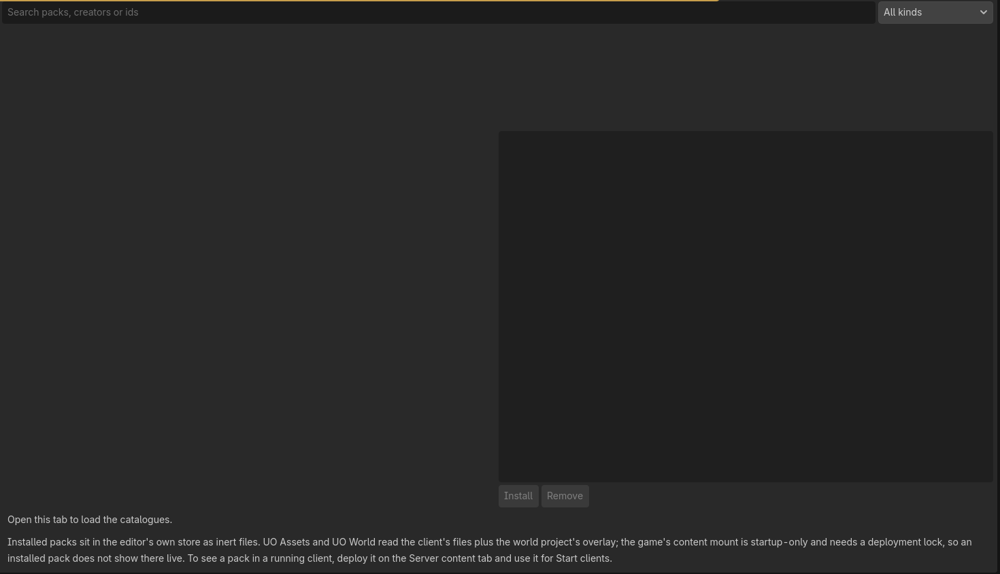

# Asset Store



Empty catalogue browsing surface. This tour did not fetch a catalogue, install a pack or accept a signing key. [Capture conditions and limits](Visual-Guide.md#content-store).


The GodotUO Asset Store installs **content packs** into the client: login and
game backgrounds, screen-saver loops, themes, sounds and profile presets.
Options > **Store** shows a catalogue where you can search, filter by kind,
install, update and uninstall.

## What a pack can and can't do

- A pack is a ZIP of plain files plus a `manifest.json` with a hash for every
  file.
- Installing a pack only stores its files. It never runs code, never merges
  arbitrary settings into your profile, and never replaces game art.
- **Art overrides are disabled.** UO art is proprietary, and the Store doesn't
  carry it.
- The supported kinds are `background`, `theme`, `sound`, `profile-preset`,
  `screensaver`, `postfx` (screen effect looks), `razor-script` (Razor
  scripts: stored and previewed, never run on install) and `content`
  (version 2 packs, below).

## Content packs (version 2)

A `content` pack lists typed components. Three are new: `hd-art`, `splat`
and `voice`. Installing one runs nothing and decodes nothing.

- **HD art** is used by the Enhanced HD option (Options, off by default).
  Anything a pack does not cover stays native art.
- **Voice** packs are used by the regional audio option (Options > Sound, off
  by default).
- **Splats** have no client consumer yet; activating one is refused.

See [Content Packs](Content-Packs.md) and `docs/asset_pack_ecosystem.md`.

## How installs stay safe

- The catalogue's index gives each pack's hash, and the download is checked
  against it.
- Every file is then checked against the manifest.
- An install is unpacked beside its destination and swapped in only after
  every check passes, so a bad download never replaces a good pack.
- The client refuses:
  - links, path traversal, names that differ only in case, executables,
    UO data files and oversized content;
  - redirects: packs must come from the configured store address.
- Versions never change once published. An update adds the new version beside
  the old one, which stays until you remove it. A pack that leaves the
  catalogue stays removable offline.
- On a remote store, HTTPS proves who published a pack. Hashes check integrity
  only; they aren't signatures.

## Running a store

`tools/asset_store` (Python standard library only) checks, publishes, indexes
and serves packs from a folder:

```
python tools\asset_store\run.py --help
python tools\asset_store\seed.py      the ten built-in CC0 background loops as store packs
python tools\asset_store\samples.py   optional sample themes, sounds and profile presets
python tools\asset_store\smoke.py     publish, install, update and uninstall, end to end
```

Point the client at a store with `UO_STORE_URL`, or set a per-character store
address in Options. The store's root also serves a searchable static page of
pack cards. `launchers\store` has keygen, open, publish and serve. A template
for the official catalogue's repository is in `tools/asset_store/catalogue_repo`;
public hosting is not live yet.

## Making a pack

The pack and index format is `docs/data_formats.md` section 12, which is the
contract for both the publisher and the client. Only publish content you hold
the rights to, and put its licence in the pack's manifest.

The design record is ADR-0019 (`docs/architecture/ADR-0019-asset-store.md`).

## Who goes where

- **Players**: the game client. Options, Video, Store lists the catalogues, asks you to approve a new catalogue's
  key, and installs packs. A shard that publishes content installs its packs automatically when you press Play.
- **Shard owners and pack authors**: the GUO editor's **UO Store** tab (next to UO World and UO Assets). Browse and
  install into the editor's own store, deploy a pack to one of your server profiles (ModernUO, ServUO, RunUO, POL,
  Sphere, UOX3), see what each server has deployed and roll back, verify a pack ZIP, publish it to a local store and
  prepare the pull request for the official catalogue. See `tools/asset_store/README.md`.
