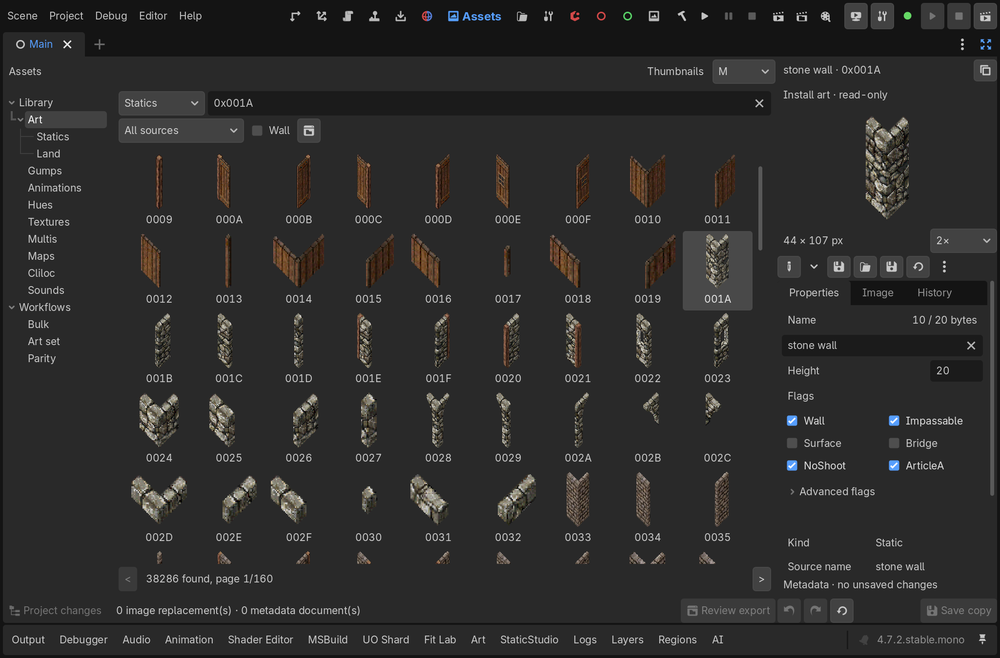
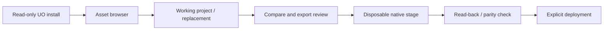
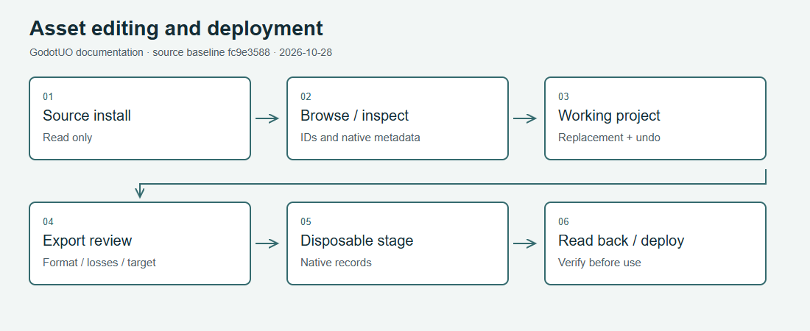

# Assets and Fiddler workflows

Library, paged art grid and item metadata. The harness requested 1366-wide logical sizing; the actual image is 2049 × 1350 because of desktop DPI. [Capture conditions and limits](Visual-Guide.md#assets-workbench).

GUO's editor combines a UO asset browser, working documents, staged native
exports and external editors. “Fiddler” describes compatibility workflows;
it does not mean every UOFiddler operation or file format is supported.
The exact format guides are linked below.

## Browse before editing

Open `launchers\editor\open_project.bat`, then UO Assets. Choose the asset
kind and search by name, decimal ID or hex ID. Asset fields elsewhere in
the editor accept IDs, suggestions, drag/drop and a picker; click their preview
to reveal the asset. [Editor](Editor.md#asset-fields) explains keyboard shortcuts.

The source installation is read-only. Work in a world/asset project, and
distinguish the source preview from the working replacement. Save the project
before closing; previewing a replacement is not a native-data deployment.

## Choose an editing path

| Task | Workflow and limits |
|---|---|
| Static art/land/gumps/textures | Browse, create a working replacement, compare source, review export; [Static Studio](../editor_staticstudio.md) |
| External pixel editing | Export PNG/sidecar, edit in Pixelorama or your editor, import and validate; [uopack](../../tools/uopack/README.md), [Pixelorama](../../tools/pixelorama/README.md) |
| Hue editing | Review a complete native hue candidate and its stage; [native hue staging](../editor/hue_native_staging.md) |
| String tables | Choose the declared text encoding and review conversion; [cliloc CSV](../editor/cliloc_csv_exchange.md), [custom sources](../editor/cliloc_custom_sources.md) |
| Multi exchange | Select the specific Fiddler format; [TXT/UOA](../editor/multi_fiddler_txt.md); other supported formats have separate guides in the [editor reference](../editor/) |
| Layouts and gumps | [Gump Studio](../ui/gump_studio.md): classic layout and native forms, capture/apply limits |
| New native slots/animations | [Author UO Data](Author-UO-Data.md), [uodata_write](../../tools/uodata_write/README.md) |
| Extracted asset sets | [Art extraction](../art_extract.md), [art_extract tool](../../tools/art_extract/README.md); output is your local derived data |

## Review and stage

[Diagram image](../images/guides/asset-pipeline.png) ·
[SVG](../images/guides/asset-pipeline.svg)

1. Preserve the source and the working project. Choose the target stage explicitly.
2. Inspect unsupported fields, ranges, hue loss and quantization before applying.
   A permissive import does not imply a lossless export.
3. Confirm the native apply step, then read the stage back independently.
4. Deploy only the reviewed stage to a scratch client/server before real use.

[Fiddler parity](../../tools/fiddler_parity/README.md) documents independent
read-back oracles, pinned upstream evidence and the limits of each proof.
Static-art or TXT proof does not certify every other asset or multi format.
[Asset roundtrip](../../tools/editor_asset_roundtrip/README.md) tests whether
project replacements actually reach the client.

## Recovery and distribution

Cancel a prepared export if the stage, format or loss report is wrong.
Use the workflow's recovery path to restore its prior stage state; do not
repair an unknown stage by overwriting your original install. Retain your
project and intentional authoring inputs independently of disposable outputs.
Publish only artwork/content you have rights to distribute. Never upload
extracted original UO art, archives or a staged data set to a public issue.

## All format and authoring guides

[Editor Authoring Reference](Editor-Authoring-Reference.md) links every audited asset workbench, metadata, hue, cliloc, sound, texture and multi interchange guide, with common limits and review boundaries.
