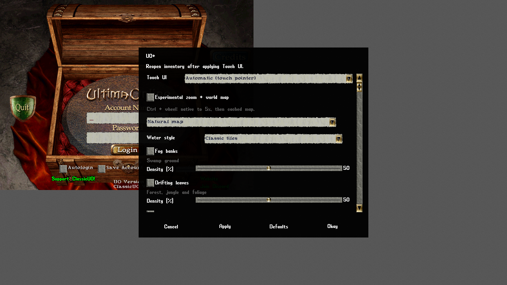

# Gameplay and settings

1280 × 720 local UI probe: touch mode, experimental zoom, water and ambient toggles. This is a probe fixture, not a player profile recommendation. [Capture conditions and limits](Visual-Guide.md#uoplus-options).

Start with a server you are allowed to use. GUO's local ModernUO validation
does not establish support for every public shard or every server script.
The [compatibility grid](Server-Compatibility.md) records individual cases,
including failures and cases that have never run.

## First session

1. Set `UO_SHARD_HOST`, `UO_SHARD_PORT` and the client version for the shard.
   Launch through `launchers\game\play.bat` and log in normally.
2. Open the paperdoll, backpack, status, skills and journal. Verify the shard
   has sent your character/items before testing interactions.
3. Use the shard's normal movement, targeting, macros and item interactions.
   Dragging an item, equipping it, buying something and trading all need a
   server response; a local cursor or animation alone is not success.
4. Arrange gumps and save your profile. [Gump Size and Screen](Gump-Size-and-Screen.md)
   covers scaling, handles and screen transfer. [Controller](Controller.md)
   and [Mobile UI](Mobile-UI.md) cover other input methods.

The historical playtest exercises walking, gumps, targeting, equipment,
combat, shopping and trade. Its scope is described in
[the port plan](../port_plan.md) and [probes](Scripted-Runs-and-Probes.md).
This documentation audit does not rerun those gameplay cases.

## Settings families

| Area | What to adjust | Guide/source |
|---|---|---|
| Screen and camera | Full-size game area, zoom, saved scale, gump placement | [Gump controls](Gump-Size-and-Screen.md), [profile fields](Profile-Reference.md) |
| Video and presentation | Classic art or optional HD; lights, water and screen effects | [Renderer](Renderer-and-Performance.md), [Water](Water.md), [Screen Effects](Screen-Effects.md) |
| Sound | Music, sound effects, footsteps/combat music; optional regional audio/recorded NPC clips | [Content Packs](Content-Packs.md), [profile source](../../godot/GUO/src/Configuration/Profile.cs) |
| Input | Mousewheel zoom, pathfinding, controller prompts, touch macro row | [Controller](Controller.md), [Mobile UI](Mobile-UI.md) |
| Containers | Classic/large/grid containers, item scale, grid loot and placement | [Grid containers](../ui/grid_container.md), [Profile Reference](Profile-Reference.md) |
| Accessibility and text | Speech/journal settings, interface language and translation | [Localization](../localization-runtime.md), [Profile Reference](Profile-Reference.md) |
| Scripts and extensions | Macros, embedded scripts, desktop mods and assistant plugins | [Scripts and languages](Scripting-and-Languages.md), [Modding](Modding.md) |
| Server/client selection | Separate editor server and client profiles and four run slots per pair | [Servers and Accounts](Servers-and-Accounts.md), [workspace](../../tools/server_manager/README.md) |

The classic Options window and modern options surfaces share profile state.
Their layouts are documented in [Modern Options](../ui/modern/options.md).
The [Profile Reference](Profile-Reference.md) lists scalar property initializers;
the platform migrations can change the effective value. Prefer the UI to
editing JSON while a client is running.

## Optional enhancements and their limits

`EnhancedHD`, `ContentAudioEnabled`, `RealtimeLights`, `SpellLighting`,
`AmbientFog`, `AmbientLeaves` and `AmbientDust` start off in the profile.
`WaterStyle` starts as `classic`. Spell lighting requires realtime lights.
HD needs matching verified art; regional audio needs installed content.
Enabling a setting does not generate or download missing content.
The original-art path uses nearest sampling. See the
[profile source](../../godot/GUO/src/Configuration/Profile.cs) and
[Feature Layers](Feature-Layers.md) before treating a visual enhancement as parity.

Ambient density starts at 50 percent and its cap at 128; the source comments
define density 0–100 and cap 0–512. Existing styled-water profiles can migrate
to preserve their ripples. Those migrations are distinct from a new profile's defaults.

For a problem report, include the commit/build, platform, actual viewport,
rendering method, changed options, shard/version and reproducible steps.
Redact account names, chat, tokens and personal paths. [Troubleshooting](Troubleshooting.md)
has recovery paths and [Known Issues](Known-Issues.md) keeps dated limitations.
