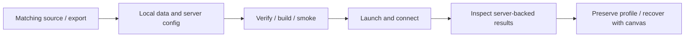
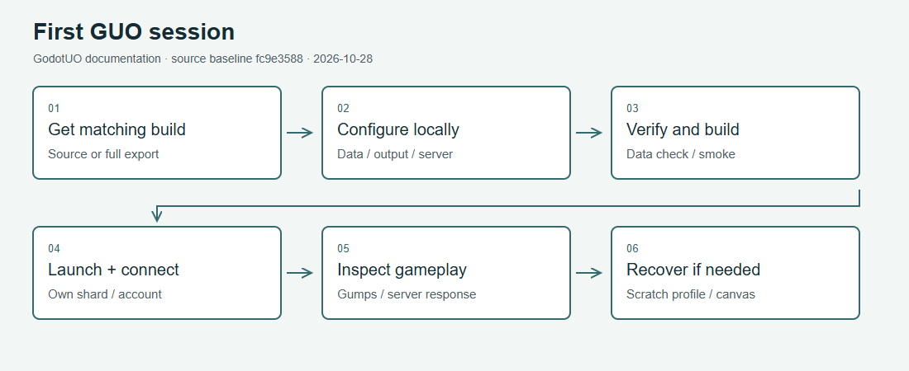

# Install and update

Use [Getting Started](Getting-Started.md) for a source build. Its requirements
are pinned by [configuration](../../launchers/_shared/config.bat), the
[C# project](../../godot/GUO/GUO.csproj) and the
[release workflow](../../.github/workflows/release.yml): Godot 4.7.2 .NET,
.NET SDK 10 for the current C# language features, desktop .NET 8 runtime,
Python 3.12+, Git and your own Classic UO data. Android/web target .NET 9;
web uses a separate community engine build. A standard non-.NET Godot build
cannot load this C# client.

## Source install

1. Clone `https://github.com/DatMoshu/GodotUO.git` and run
   `launchers\pipeline\00_bootstrap.bat`.
2. Copy `launchers\_shared\config.local.bat.example` to
   `config.local.bat` in the same folder. Set `UO_CLIENT_DATA` and
   `UO_BUILD_DIR` to your own folders. Keep generated output outside the checkout.
3. Run `launchers\pipeline\01_verify_client_data.bat`, then
   `dotnet build godot\GUO\GUO.csproj` and `launchers\dev\smoke.bat`.
4. Set your server host/port, then use `launchers\game\play.bat`.

On Linux use the `.sh` twins and `config.local.sh`; see [Linux](Linux.md).
Server setup is separate: an offline/login screen does not prove a shard
connection. [Dev Shard](Dev-Shard.md) covers a local ModernUO installation.

## Downloaded builds

The [Actions release workflow](https://github.com/DatMoshu/GodotUO/actions/workflows/release.yml)
defines Windows x86_64, Steam Deck/Linux x86_64 and Android ARM64 artifacts.
Choose a successful run and the matching artifact; record its commit.
An artifact's presence is not a support guarantee. Availability and retention
change, so use the run's actual artifact list. See [Getting Started](Getting-Started.md#download-a-build)
for command line and data setup. Web has its own [build guide](Web-Client.md).

Keep all files of an exported build together. Do not copy only the executable
over an older export: the `.pck` and .NET assemblies must match it. Supply UO
data separately; never put a data directory in a public issue attachment.

## Update safely

1. Exit the GUO instance you are updating. Preserve your local configuration,
   workspace, profiles, custom packs and any authored world project.
2. In a source checkout, inspect `git status` before pulling. Commit or stash
   your own source changes deliberately; do not overwrite another person's work.
   Update your chosen branch and rerun bootstrap only if dependencies/pins changed.
3. Rebuild and run smoke. For an artifact install, unpack the new complete
   export into a separate folder and test it before retiring the previous one.
4. Check your server and client versions. A data or protocol mismatch is not
   fixed by deleting profiles. The editor's server/client profiles report
   expected-version or data differences; [Configuration](Configuration.md)
   explains path precedence.

Profile defaults can migrate by platform/version. The
[platform table](../../godot/GUO/src/Configuration/PlatformDefaults.cs)
preserves values that differ from the old default; a value deliberately set
back to that old default may migrate once. Keep a backup before upgrading.
Wide play-session zoom is clamped to 2.5 when profiles save/load, so a new
login does not begin at the widest experimental view.

## Recovery

Use a separate scratch profile to isolate a settings problem before altering
your normal one. Try [canvas recovery](Renderer-and-Performance.md#recover-with-canvas)
for rendering problems. A missing engine, SDK, data path or external dependency
should be addressed by the target's doctor, not by deleting your installation.

## Workflow at a glance

[SVG fallback](../images/guides/first-session.svg)
