# Visual guide and capture register

These are real GUO screenshots, captured on 2026-10-28 from source baseline
`fc9e35880bcd201d4ed78aa9de562b2d971cc496`, using Godot
`4.7.2.stable.mono.official.ed1daf0bf`, Debug/editor with `GuoLabs=false`.
An isolated settings/workspace profile and locally installed UO `7.0.107.76`
were used. Original client files and extracted artwork are not redistributed.

The editor tour ran **without a live shard** at 1920 × 1080, editor scale 1.
It supplies its own yellow callouts and normalizes personal paths/endpoints.
Selected images are cropped and losslessly PNG-optimized; no UI is fabricated.
Click an image to inspect its native size. Per-image dimensions and hashes are
in the [public asset register](../images/guides/captures.json).

## What these pictures prove

A capture shows the pictured layout and state. It does not prove motion,
performance, network round trips, provider authentication or every action
available in a tab. The tour ended with failed checks against several moved
legacy controls, including edit/overlay markers. The targeted Assets run
failed native hue preparation verification. Full source-only smoke built
successfully but failed sound batch export; its splat-LOD fixture check also
failed. None is presented as a passing end-to-end run. Gump Studio reported
39 checks passing; its visual process also logged disposal errors at shutdown.
The separate UO+ options probe reported Apply/Defaults/Cancel and focus/scroll
checks passing. This is documentation evidence, not a gameplay acceptance gate.

## Screenshot index

| Surface | Guide | Capture |
|---|---|---|
| Classic login | [Getting Started](Getting-Started.md) | [login](#login) |
| UO+ options | [Gameplay and Settings](Gameplay-and-Settings.md) | [uoplus-options](#uoplus-options) |
| Assets workbench | [Assets and Fiddler](Assets-and-Fiddler.md) | [assets-workbench](#assets-workbench) |
| Search by asset ID | [Editor](Editor.md) | [asset-search](#asset-search) |
| Gump art browser | [Assets and Fiddler](Assets-and-Fiddler.md) | [gump-browser](#gump-browser) |
| Animation browser | [Assets and Fiddler](Assets-and-Fiddler.md) | [animation-browser](#animation-browser) |
| Hue working palette | [Assets and Fiddler](Assets-and-Fiddler.md) | [hue-operations](#hue-operations) |
| Hue import review | [Assets and Fiddler](Assets-and-Fiddler.md) | [hue-import](#hue-import) |
| Cliloc CSV review | [Assets and Fiddler](Assets-and-Fiddler.md) | [cliloc-import](#cliloc-import) |
| Cliloc language selection | [Assets and Fiddler](Assets-and-Fiddler.md) | [cliloc-japanese](#cliloc-japanese) |
| Sound browser | [Assets and Fiddler](Assets-and-Fiddler.md) | [sound-browser](#sound-browser) |
| WAV import review | [Assets and Fiddler](Assets-and-Fiddler.md) | [sound-import](#sound-import) |
| Sound batch review | [Assets and Fiddler](Assets-and-Fiddler.md) | [sound-export-review](#sound-export-review) |
| Multi component browser | [Building Multis](Building-Multis.md) | [multi-browser](#multi-browser) |
| World tools and inspector | [World Editing](World-Editing.md) | [world-tools](#world-tools) |
| Cell and altitude guides | [World Editing](World-Editing.md) | [world-guides](#world-guides) |
| Minimap visibility | [World Editing](World-Editing.md) | [world-map](#world-map) |
| Water authoring | [Water](Water.md) | [water-authoring](#water-authoring) |
| AI chat controls | [AI and MCP](AI-and-MCP.md) | [ai-chat](#ai-chat) |
| Agent queue controls | [AI and MCP](AI-and-MCP.md) | [ai-queue](#ai-queue) |
| Content Store surface | [Asset Store](Asset-Store.md) | [content-store](#content-store) |
| Gump Studio | [Editor](Editor.md) | [gump-studio](#gump-studio) |
| Editor run bar | [Servers and Accounts](Servers-and-Accounts.md) | [editor-runbar](#editor-runbar) |

### Classic login

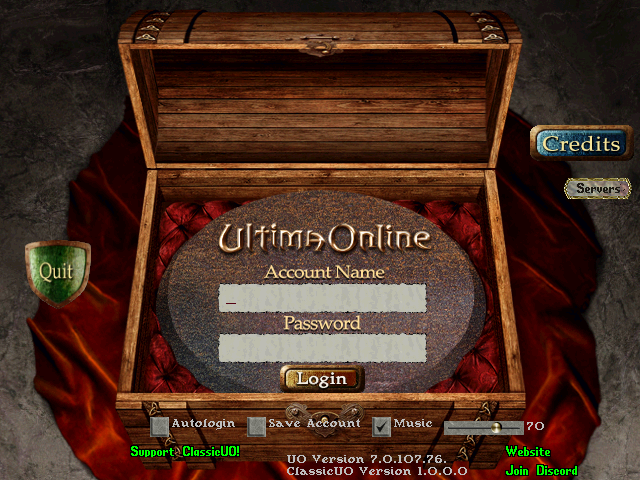

Empty account fields in the classic pregame path. Actual captured viewport is 640 × 480; no shard login was attempted. [Open the guide](Getting-Started.md).

### UO+ options

1280 × 720 local UI probe: touch mode, experimental zoom, water and ambient toggles. This is a probe fixture, not a player profile recommendation. [Open the guide](Gameplay-and-Settings.md).

### Assets workbench

Library, paged art grid and item metadata. The harness requested 1366-wide logical sizing; the actual image is 2049 × 1350 because of desktop DPI. [Open the guide](Assets-and-Fiddler.md).

### Search by asset ID

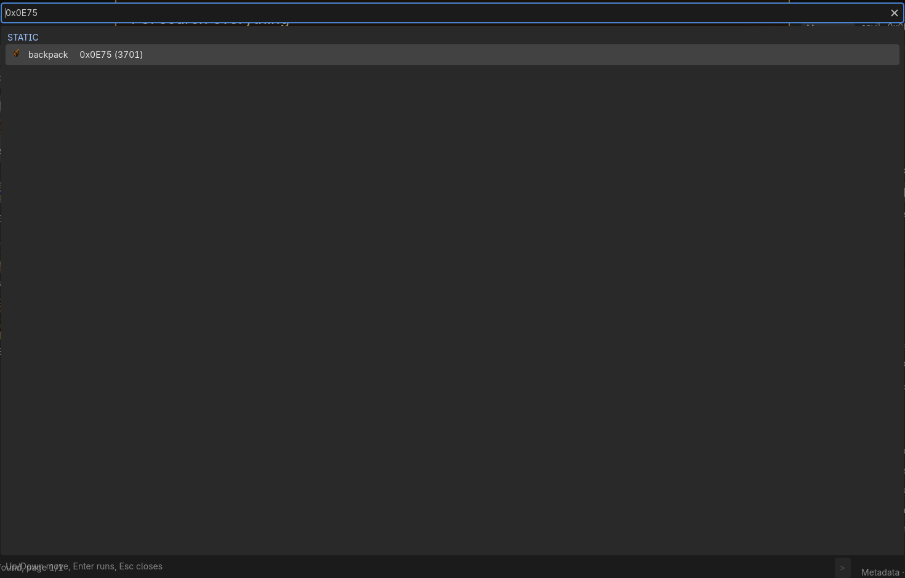

F3-style search locating backpack 0x0E75. The image is cropped to the search surface; selection does not modify installed art. [Open the guide](Editor.md).

### Gump art browser

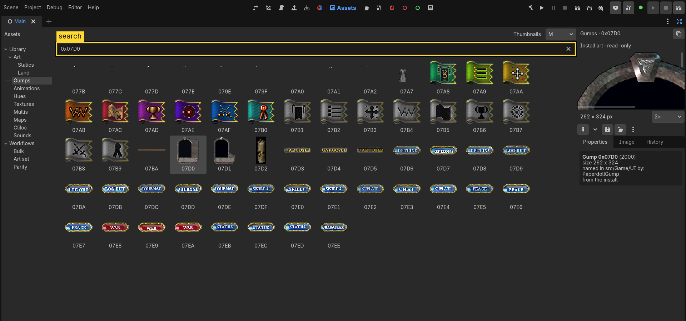

Gump 0x07D0 with its source class reference. Browse UI art here; use Gump Studio to author layouts. [Open the guide](Assets-and-Fiddler.md).

### Animation browser

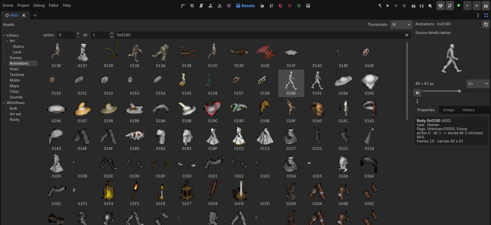

Body, action and direction controls with frame preview. A still does not verify playback or equipment layering. [Open the guide](Assets-and-Fiddler.md).

### Hue working palette

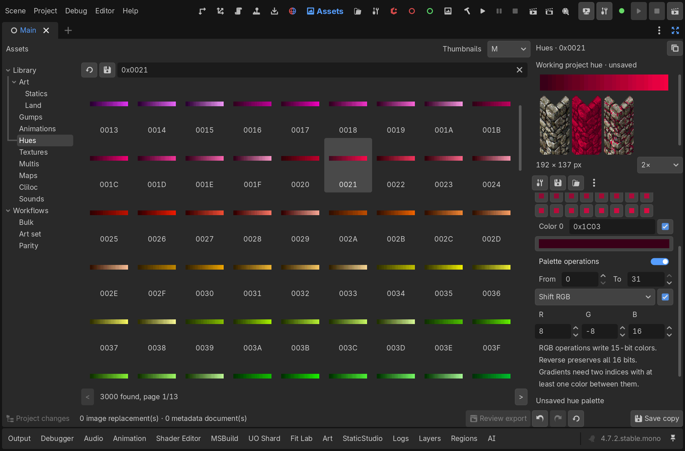

Project hue editing, comparison preview and range operations. Native hue preparation failed independent verification in this capture run; this image is not an export success receipt. [Open the guide](Assets-and-Fiddler.md).

### Hue import review

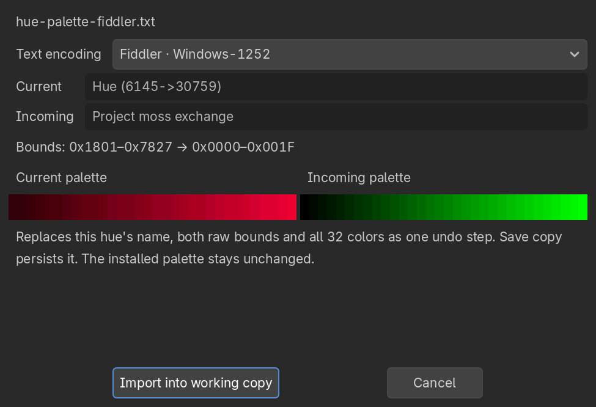

Fiddler text palette compared with the current working palette before an undoable import. The installed palette stays unchanged. [Open the guide](Assets-and-Fiddler.md).

### Cliloc CSV review

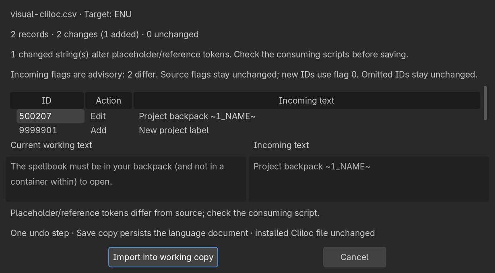

Synthetic project text with changed placeholder tokens, shown before importing into a working copy. Review tokens against consuming scripts. [Open the guide](Assets-and-Fiddler.md).

### Cliloc language selection

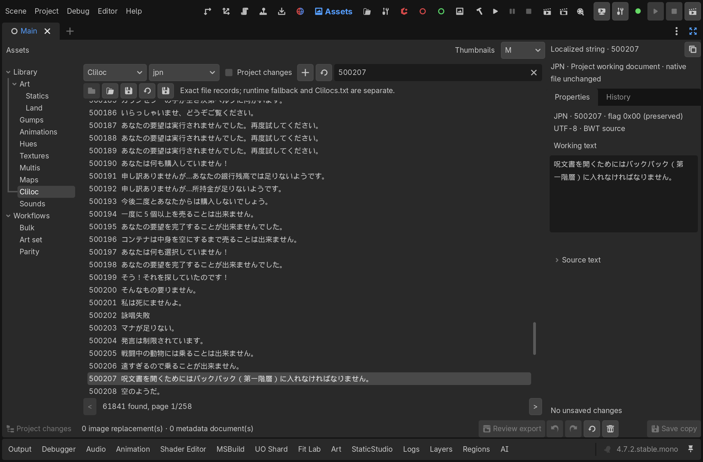

Japanese source strings displayed in the working-document UI. This does not prove runtime translation provider support. [Open the guide](Assets-and-Fiddler.md).

### Sound browser

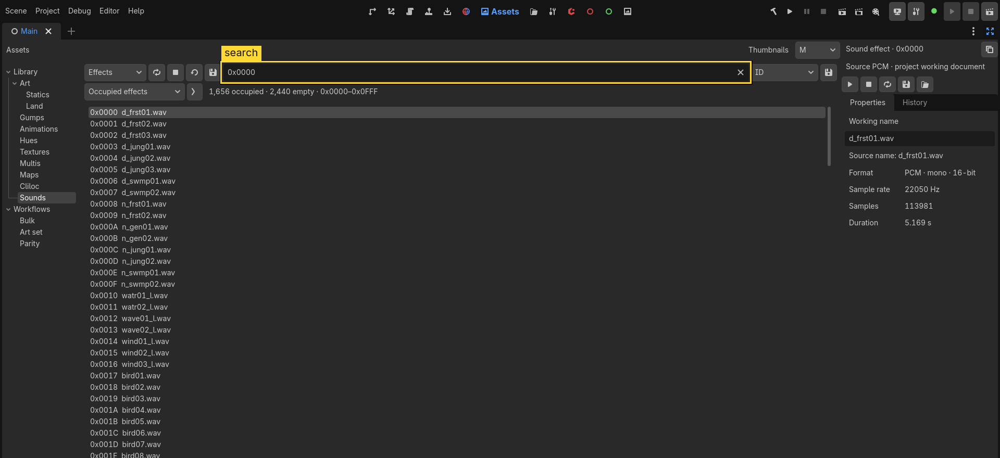

Occupied sound IDs and PCM metadata. A screenshot cannot demonstrate audible output. [Open the guide](Assets-and-Fiddler.md).

### WAV import review

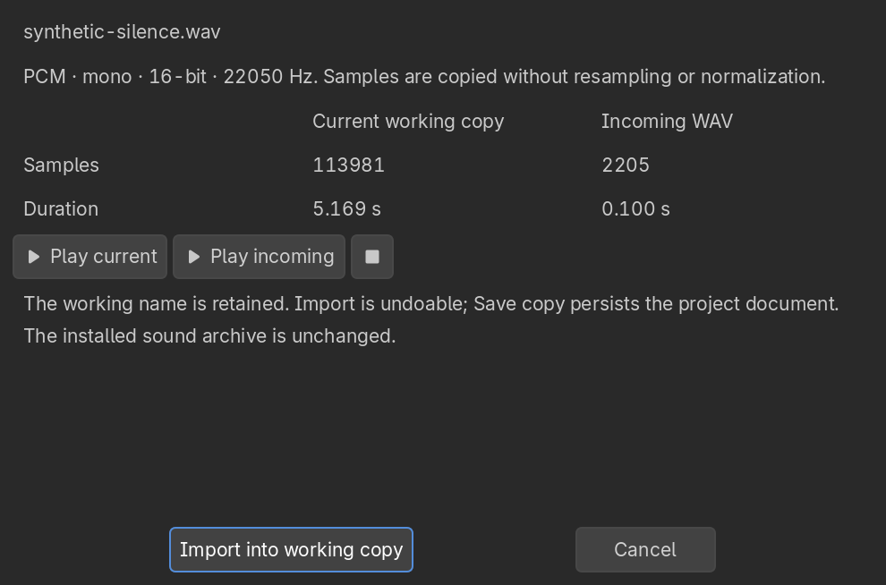

Synthetic silence compared with source PCM before an undoable working-copy import. No source sound archive is distributed. [Open the guide](Assets-and-Fiddler.md).

### Sound batch review

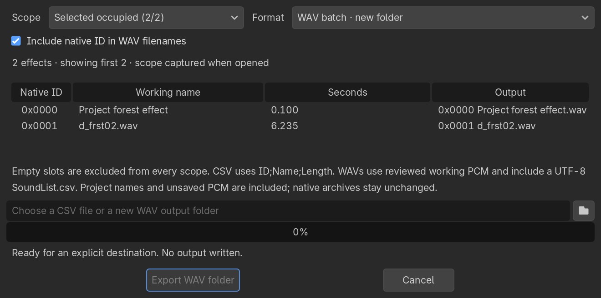

Selected effects, output naming and destination controls before writing. The full source-only smoke failed sound batch export; this picture proves layout only. [Open the guide](Assets-and-Fiddler.md).

### Multi component browser

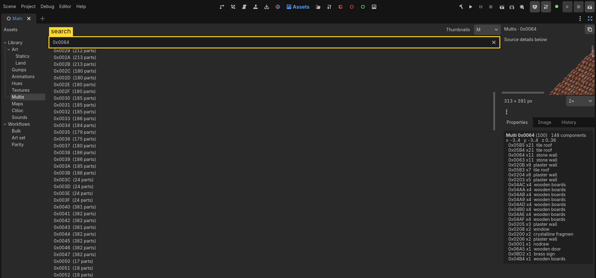

House multi 0x0064 with its component list. The preview is clipped at this layout; this is not a complete multi render or native staging proof. [Open the guide](Building-Multis.md).

### World tools and inspector

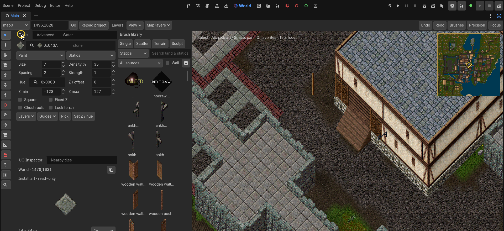

Britain in the editor with brush library, picker and minimap. No live shard is connected. [Open the guide](World-Editing.md).

### Cell and altitude guides

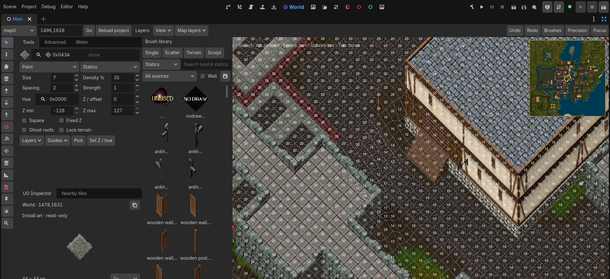

Editor-only cell grid and altitude numbers over the world view. These overlays are separate from normal player rendering. [Open the guide](World-Editing.md).

### Minimap visibility

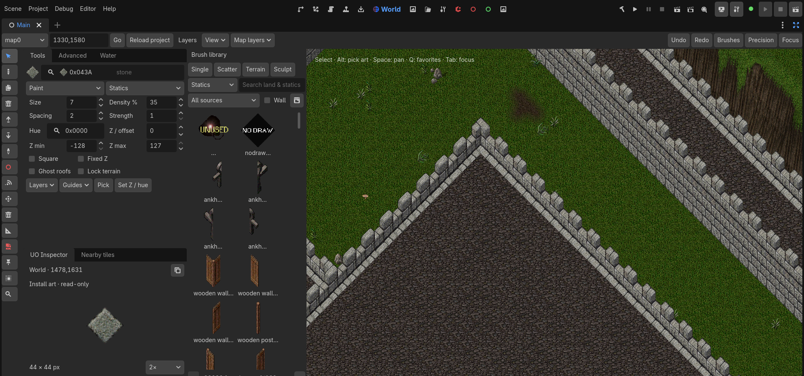

A different map location with the minimap hidden. This is an editor view, not proof of navigation packets or player movement. [Open the guide](World-Editing.md).

### Water authoring

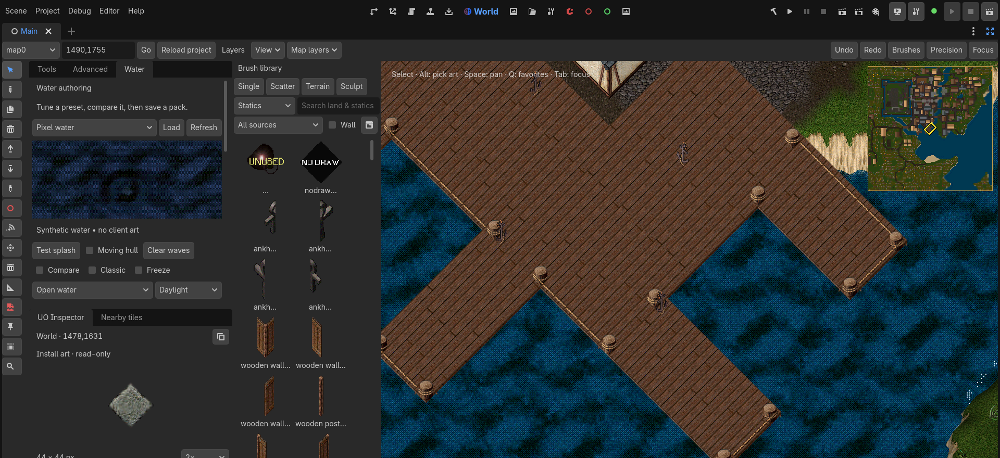

Water controls and Britain docks. The left test preview is explicitly synthetic; the right view uses installed art. No shard is needed for the preview. [Open the guide](Water.md).

### AI chat controls

Cropped AI dock with an empty conversation. The tour normalizes local endpoint text; no prompt was sent and no provider session was tested. [Open the guide](AI-and-MCP.md).

### Agent queue controls

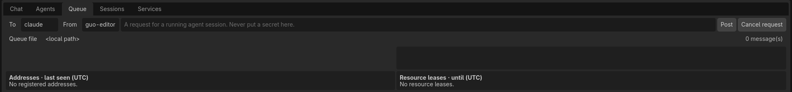

Empty shared request queue with no registered addresses or leases. This is not proof of delivery to an external agent. [Open the guide](AI-and-MCP.md).

### Content Store surface

Empty catalogue browsing surface. This tour did not fetch a catalogue, install a pack or accept a signing key. [Open the guide](Asset-Store.md).

### Gump Studio

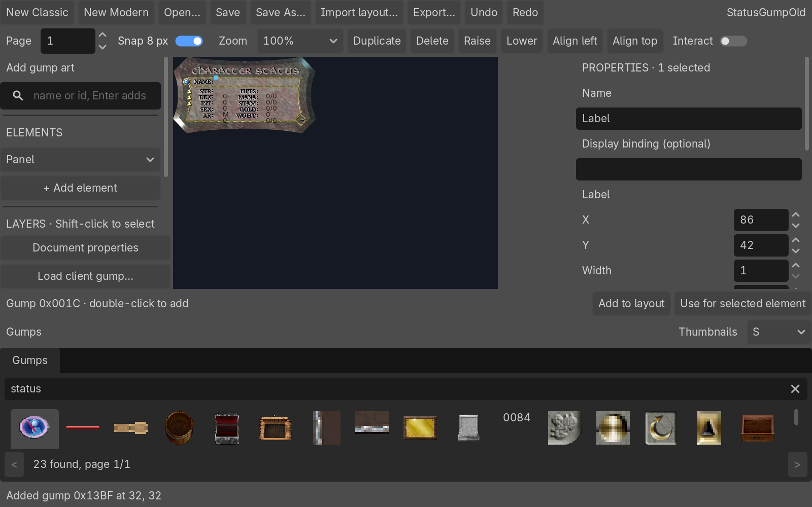

1600 × 1000 authoring surface with an imported classic status layout and element properties. Fixture values are synthetic. [Open the guide](Editor.md).

### Editor run bar

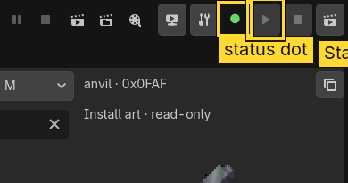

The existing tour highlights run controls. Its green status indicator is tour state; no live-server readiness is inferred. [Open the guide](Servers-and-Accounts.md).

## Existing gameplay illustration

This retained repository illustration is historical: its original build,
profile and viewport were not recorded. It is not proof of current renderer
correctness.

## Documentation diagrams

| Diagram | Explains | Alternative |
|---|---|---|
| [Architecture](Architecture.md) | Client state, Godot host, rendering and editor boundaries | [PNG](../images/guides/architecture.png), [SVG](../images/guides/architecture.svg) |
| [Asset pipeline](Assets-and-Fiddler.md#review-and-stage) | Source, project, review, stage and read-back | [PNG](../images/guides/asset-pipeline.png), [SVG](../images/guides/asset-pipeline.svg) |
| [AI tool flow](AI-and-MCP.md#request-flow) | Gate, permission, approval, dispatch and result | [PNG](../images/guides/ai-tool-flow.png), [SVG](../images/guides/ai-tool-flow.svg) |
| [Install workflow](Install-and-Update.md) | Configure, verify, build, connect and recover | [PNG](../images/guides/first-session.png), [SVG](../images/guides/first-session.svg) |

## Capture gaps

The [feature matrix](Feature-Coverage.md) is broader than this gallery.
New connected gameplay, all Options pages, renderer variants, every Fiddler
exchange, native staging/read-back, Admin mutations, live edits, physical
devices and external AI sessions need separate receipts. Source references
and historical proofs remain useful, but are not current visual coverage.
